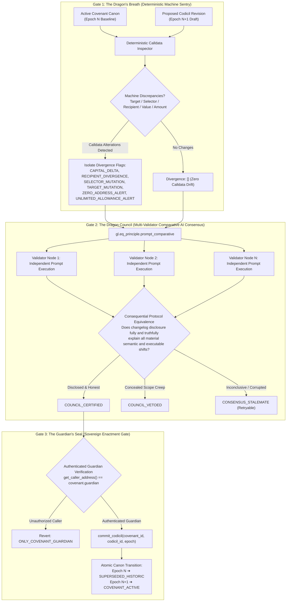

# 🐉 WYRM WARD

> **Autonomous Governance Covenant & Revision Sentry on GenLayer**  
> *Governed by Deterministic Calldata Machine Sentry, Multi-Validator Comparative AI Consensus, and Sovereign Guardian Enactment Gates.*

[](https://explorer-studio-next.genlayer.com/address/0xE070F977429707e9c2dd2eb7E4B58404627f3363)
[](https://explorer-studio-next.genlayer.com/address/0xE070F977429707e9c2dd2eb7E4B58404627f3363)
[](contracts/wyrm_ward.py)
[](tests/test_wyrm_ward.py)
[](frontend/)
[](LICENSE)

---

### 🌐 Live On-Chain Deployment

| Property | Value |
| :--- | :--- |
| **Network** | GenLayer Studio Next |
| **Chain ID** | `61997` |
| **Contract Address** | [`0xE070F977429707e9c2dd2eb7E4B58404627f3363`](https://explorer-studio-next.genlayer.com/address/0xE070F977429707e9c2dd2eb7E4B58404627f3363) |
| **Block Explorer** | [explorer-studio-next.genlayer.com/address/0xE070F977429707e9c2dd2eb7E4B58404627f3363](https://explorer-studio-next.genlayer.com/address/0xE070F977429707e9c2dd2eb7E4B58404627f3363) |
| **Status** | Active & Finalized on GenVM |

---

## 🏛️ Executive Summary & The Governance Drift Vector

In decentralized autonomous organizations (DAOs), foundational covenants, grant mandates, and treasury charters frequently undergo community amendments. While traditional smart contracts excel at verifying cryptographic signatures and balance arithmetic, they are **fundamentally blind to natural-language prose**:

- **The Semantic Blindspot:** An EVM contract cannot understand whether an amended mandate subtly removes multisig co-signers, broadens spending discretion, or alters delivery covenants.
- **The Deceptive Changelog Attack:** An adversarial proposer submits a misleading summary claiming *"Minor formatting polish and typographical fixes"*, while quietly increasing payout caps or diverting calldata recipients to offshore wallets.
- **The Oracle Fragility Trap:** Offloading text verification to centralized off-chain bots creates single points of failure, censorship vectors, and front-running risks.
- **The Rogue AI Execution Vector:** Entrusting execution authority directly to autonomous AI models risks disastrous hallucinations triggering state transactions.

**WyrmWard** solves this by establishing a decentralized, fail-closed revision defense citadel on GenLayer. It decouples deterministic transaction calldata inspection from multi-validator semantic disclosure analysis, guaranteeing that no governance revision can become active canon without transparent disclosure and explicit guardian authorization.

---

## 🐉 The Dragon Sentry Architecture Radar

WyrmWard enforces an unyielding three-gate defense pipeline:



---

## ⚔️ Key Technical Innovations

### 1. The Dragon's Breath (Pure Code Pre-Filter)
Before invoking any non-deterministic AI models, executable transaction parameters are strictly parsed, normalized, and diffed by pure deterministic Python code:
- **`CAPITAL_DELTA`**: Flags unexpected treasury expenditure expansions.
- **`RECIPIENT_DIVERGENCE`**: Catches address diversion attempts.
- **`SELECTOR_MUTATION`**: Detects function signature tampering.
- **`ZERO_ADDRESS_ALERT`**: Rejects null address allocations (`0x000...000`).
- **`UNLIMITED_ALLOWANCE_ALERT`**: Rejects unbounded token approvals (`>= 10^30`).

### 2. The Dragon Council (Multi-Validator Comparative Consensus)
Powered by GenLayer's `gl.eq_principle.prompt_comparative`, independent validator nodes evaluate the semantic honesty of the proposer's changelog:
- **Prompt Injection Neutralization**: All user-supplied inputs (`BASELINE_PROSE`, `REVISED_PROSE`, `CHANGELOG_DISCLOSURE`) are fenced as inert data strings.
- **Deterministic Override**: If the machine pre-filter detected calldata differences, but the AI model claims the proposal is editorial, the protocol **deterministically overrides the hallucination and forces a veto**.
- **Fail-Closed Consensus Handling**: Corrupted or malformed validator outputs safely map to `CONSENSUS_STALEMATE`, preserving state integrity.

### 3. The Guardian's Seal (Enactment Guard)
AI models never hold execution authority. The Dragon Council can only certify or veto. Only the authenticated covenant guardian can commit a certified revision into active canon.

---

## 🧪 Verification & Test Suite

All 4 layers pass automated checks via `./verify.sh`:

```bash
./verify.sh
```

### 1. GenVM Linter
```bash
python3 -X utf8 -m genvm_linter.cli contracts/wyrm_ward.py
```
*Expected Output:* `✓ Lint passed (3 checks, 0 errors)`

### 2. Pytest Intelligent Contract Suite
```bash
python3 -m pytest tests -q
```
*Expected Output:* `21 passed in 0.05s`

### 3. Frontend Lifecycle State Tests
```bash
cd frontend && npm test
```
*Expected Output:* `ℹ pass 3, ℹ fail 0`

### 4. Production Web Application Build
```bash
cd frontend && npm run build
```
*Expected Output:* `✓ built in ~250ms (0 TypeScript errors)`

---

## 🌐 Deployment Guide on GenLayer Studio Next

1. Open [GenLayer Studio IDE](https://studio.genlayer.com).
2. Connect to **GenLayer Studio Next (Chain ID: 61997)**.
3. Import `contracts/wyrm_ward.py`.
4. Deploy the contract (the constructor initializes storage automatically with zero arguments).
5. Copy the deployed contract address (`0x...`).
6. Configure `frontend/.env`:
   ```bash
   VITE_CONTRACT_ADDRESS=0xYourDeployedContractAddress
   ```
7. Start the local client or deploy to Vercel:
   ```bash
   cd frontend && npm run dev
   ```

---

## 📜 License
MIT License. Built for the GenLayer Ecosystem.
