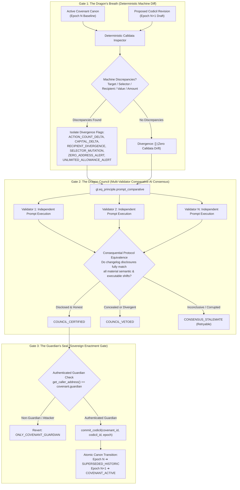

# 🐉 WyrmWard Technical Architecture

## 1. System Overview

**WyrmWard** is an autonomous governance covenant and revision sentry built on GenLayer. It enforces strict cryptographic, deterministic, and semantic boundaries over DAO charters, treasury allocations, and grant covenants.

---

## 2. The Three Dragon Sentry Gates

---

## 3. Storage Architecture

WyrmWard utilizes GenVM's persistent storage primitives (`TreeMap[u256, str]`) with canonical JSON normalization to prevent state divergence and optimize validator memory:

- `covenants: TreeMap[u256, str]`: Maps covenant IDs to primary registry records.
- `codicils: TreeMap[u256, str]`: Maps revision/codicil IDs to immutable revision records.
- `verdicts: TreeMap[u256, str]`: Maps adjudication IDs to multi-validator council decision records.

---

## 4. State Machine & Lifecycle Vocabulary

| State | Scope | Description |
|---|---|---|
| `COVENANT_ACTIVE` | Covenants & Codicils | Currently sealed canonical authority for the DAO or guild. |
| `CODICIL_PENDING` | Codicils | Proposed draft awaiting Dragon Council adjudication. |
| `COUNCIL_CERTIFIED` | Codicils | Verified by validators as completely disclosed and eligible for enactment. |
| `COUNCIL_VETOED` | Codicils | Rejected by validators due to concealed scope creep or calldata mismatch. |
| `CONSENSUS_STALEMATE` | Codicils | Inconclusive validator agreement; safely retryable without state corruption. |
| `SUPERSEDED_HISTORIC` | Codicils | Former canon superseded by an enacted child epoch. |
